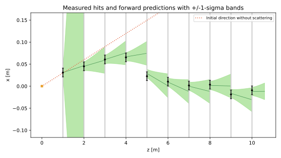

# Kalman filter reference and extensions

The Day 2 notebooks contain the working instructions and completion checks:
[01 tracking](../code/day2/01_tracking.ipynb),
[02 calibration](../code/day2/02_calibration.ipynb) and
[03 height and velocity](../code/day2/03_height_velocity.ipynb).
The height/velocity notebook exposes the model, four filter expressions and
velocity-constraint update alongside its comparisons.
The [programme](day_2_kalman.md) owns the timetable: 215 minutes of practicals.
This note provides additional conventions and interpretation; the theory notes
and detector analogies are optional background.

## E1: follow a particle track

The notebook defines the ten-plane experiment. The details below document the
reference calculation and optional geometry/plot studies.

**Conventions to agree.** The reference measures first and scatters afterwards.
Its filtered state at the last plane is therefore the incoming state, before
that plane's kick. The kick covariance at a plane is
$Q_{\mathrm{plane}}=\mathrm{diag}(0,0.02^2)$. Over the next gap d,

$$F=\begin{pmatrix}1&d\\0&1\end{pmatrix},\qquad
Q_{\mathrm{gap}}=FQ_{\mathrm{plane}}F^T
=0.02^2\begin{pmatrix}d^2&d\\d&1\end{pmatrix},\qquad
H=(1,0),\qquad V=0.01^2\,\mathrm{m}^2.$$

A kick changes position uncertainty only after propagation. The first gap from
z = 0 to z = 1 contains no scattering plane. The reference starts truth with the
example 0.1 m / 0.1 spreads, and uses a zero-mean fit with initial standard
deviations 1 m / 1. A broad fit prior can affect pulls; check its influence
rather than imposing unit width by rescaling the errors.

**Reference.** Try your implementation first, or enable the notebook's reference.
From `code/` with the course environment active:

```text
python -m day2.tracking --tracks 1000 --seed 7 --output ../day2/tracking/trial-01
```

A fresh output directory receives individual fits and covariances (`tracks.csv`),
summary statistics (`summary.json`), an illustrated track (`track.png`, `track.svg`)
and pull histograms (`pulls.png`). The reference filter is checked against an
independent joint Gaussian solution using the same fit prior.

**Optional plot challenge.** Reproduce the green prediction bands below:
grey planes, measured hits, widening bands between planes and contraction at
each update. Include a dotted initial straight-line reference. Propagate
$\sigma_x^2(d)=C_{xx}+2dC_{xt}+d^2C_{tt}$ after adding the local slope-kick
variance; label the bands as one standard deviation.



**Optional geometry check.** The reference's all-plane control includes virtual
hits beyond the active interval $-0.5\leq x\leq0.5\,\mathrm{m}$ and reports the
number of fully contained tracks. With `--finite-aperture`, omit those hits but keep
all 1,000 attempted tracks. Material is assumed to extend beyond the readout.
Missing-hit information and selecting contained tracks change the statistical
problem, so Gaussian pull calibration needs care. With `--outgoing`, the final
unobserved kick increases slope variance by $0.02^2$ without changing the mean.

## E2: calibrate before tuning

The notebook contains the 45-minute calibration exercise and its acquisition,
calculation and validation cells. The
[calibration reference](sensor_bias_calibration_exercise.md#e2-core-45-minutes)
explains what each reference condition can identify and separates optional studies.
Gyro calibration remains a separate diagnostic. Gyro covariance describes
angular-rate observations; it cannot supply the range
measurement variance V used by E3. A single stationary pose constrains the
gravity signal but does not identify all accelerometer biases and scales.

## E3: construct and tune a height-velocity filter

The notebook gives F, B, H, Q and the prediction/update equations. Its range
standard deviation comes from the initial stationary interval, with a 1 mm
floor. Observed spread describes repeatability under those conditions;
absolute accuracy needs an independent reference.

The velocity correction comes from position–velocity cross-covariance.
Setting that covariance to zero removes the velocity correction for the
current position observation. Changing V changes both gain components; its
effect depends on the predicted covariance as well as sensor resolution.

When comparing acceleration integration, range differentiation and filtering,
use the same timestamps and calibration. Differentiation amplifies measurement
noise; integration accumulates offsets. Startup, model lag and correlations can
affect residuals even when the traces look smooth. Inspect pre-gate
[pulls and whitening](glossary.md#whitening-and-cholesky-factorization);
compare error and coverage only when independent truth exists. The helper
separates the first two filtering seconds from later summaries.

## E4: one outlier and its rejection

A large predicted-residual chi-square can reflect an outlier, an inadequate
propagation model, incorrect Q/V, timing error or changed floor geometry.
Keep rejected observations in diagnostic plots and count clean-data rejections:
accepted-only distributions are selected data. A raised floor changes the
measurement model rather than establishing random range noise.

## E5: missing range and a known-rest constraint

A known-rest update supplies a zero-velocity observation with finite variance.
It changes both the mean and covariance through the measurement update.
Quiet inertial readings also occur during constant-speed translation;
stationarity needs independent evidence. A false rest constraint can produce
small quoted uncertainty around a biased estimate.

## E6: frozen assumptions on fresh data

Use the notebook's fresh-data comparison; do not fit the validation data.
The new recording establishes its initial height and declares zero initial
velocity at rest, with finite uncertainty. Interpret this startup separately
from later performance. Simulated validation checks implementation consistency
under declared noise and calibration assumptions; fresh measured data test
whether those assumptions transfer to the actual drone.

## E7: carry the filter's uncertainty into a race decision

The height filter supplies vertical variance. Horizontal entries in a
three-dimensional clearance calculation need separate evidence or stated
assumptions. Mapping floor-relative height variance to world Z also assumes a
known floor; survey and floor uncertainty need their own allowance.

A worst-axis sigma multiplier is a conservative allowance, not an exact
collision probability. Tracking and estimation allowances can overlap.
Recommended speeds in these estimation exercises do not change prescribed
truth motion and therefore do not establish lap-time improvements.

## Recording and replay reference

The [recording guide](sensor_recording_contract.md) documents the motor-stop
procedure, bounded capture, timing, calibration, CSV/metadata schemas and CLI
alternative. The notebook keeps the handling instructions beside its live cells.
A failed selection clears the previous dataset; choose the saved recording or
simulated fallback explicitly.

Additional [six-state tools](../code/day2/six_state_reference.md) support
asynchronous sensors and comparisons with correlated onboard estimates. Their
recording format and model differ from the scheduled vertical experiment.

## Submission and closing discussion

Keep one useful comparison in the team's shared notes, at most one page,
linking the notebooks, recordings, settings and plots. No separate exercise reports are needed.
The [shared conventions](practical_workflow.md) give the common recording
principles; the [notes template](templates/kalman_filter_report.md) offers optional prompts.

For automated analysis, an optional `metrics.csv` can use:
`exercise,run_id,config_id,seed,data_id,interval,sensor,m,
n_updates,accepted,rejected,position_rmse_m,max_position_error_m,coverage95_x,
coverage95_y,coverage95_z,chi2_mean`. Use empty fields for unavailable quantities.
Keep sensor-specific chi-square dimensions separate. Quote counts and
uncertainties with success rates, and define a valid crossing.

## Stretch exercises

Once the core evidence is complete, teams interested in going further can
explore one of these extensions:

| Extension | Task | Additional evidence |
| --- | --- | --- |
| Bias state | Add accelerometer bias states with a stated random-walk model. | Recovery of injected bias, covariance, and observability under dropout; compare fixed calibration. |
| Adaptive Q | Increase model uncertainty using a justified manoeuvre indicator. | Held-out consistency and accuracy versus fixed Q, including false triggers. |
| Robust range | Compare chi-square rejection with [Tukey weighting](glossary.md#predicted-residual-gating-and-tukey-weighting) for a raised floor. | Effective noise variance, rejection/weight history, and recovery; never mistake floor change for independent Lighthouse truth. |
| Process input versus measurement | Design two explicit models using acceleration differently. | State and noise definitions, discretization, correlations, and a matched-data comparison without double-counting IMU information. |
| Attitude error-state EKF | Extend to quaternion attitude and IMU bias estimation. | Stationary and turning tests, quaternion norm, bias observability, and comparison to the six-state baseline. |
| Joint estimation/control | Tune an estimator and constrained PD/feed-forward or LQG controller together. | Fixed safety limits, closed-loop tracking/saturation/effort results, completion rate, and separation of estimator error from controller lag. |

The [race qualification and fallback policy](race_practical.md#r5-qualify-and-freeze-the-race-configuration)
applies throughout. Before using live code for control, the team completes and
cross-checks simulation, independent calibration, connection, emergency-stop and
low-speed tests, recording their outcomes. Keep the onboard attitude stabilization active.
